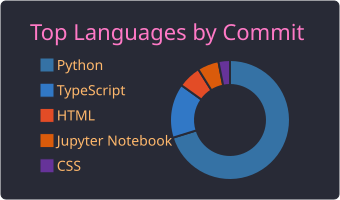

⚔️ <i>guarding my code since 2024</i> ⚔️

### Hi there! I'm Tenzin Rigzin 👋

  

  

  

<b>✨ More About Me ✨</b>

 

 

  

**🎯 Focus Areas**

  

**🚀 Featured Projects**

<table>
  <tr>
    <td align="center" width="50%">
      <h4>🔍 MobiTrace Pro</h4>
      AI-powered Android mobile forensic investigation suite
        
      
      
      
    </td>
    <td align="center" width="50%">
      <h4>📚 CampusFlow</h4>
      Student productivity app with an AI Study Buddy and Smart Deadline Manager
        
      
      
      
    </td>
  </tr>
  <tr>
    <td align="center" width="50%">
      <h4>📊 DataLens AI</h4>
      Local data-analysis app, an alternative to Julius AI
        
      
      
    </td>
    <td align="center" width="50%">
      <h4>🏙️ CityLens Analytics</h4>
      Public safety hazard detection using computer vision
        
      
      
    </td>
  </tr>
</table>

 

---

 

**Contact me!**

  

